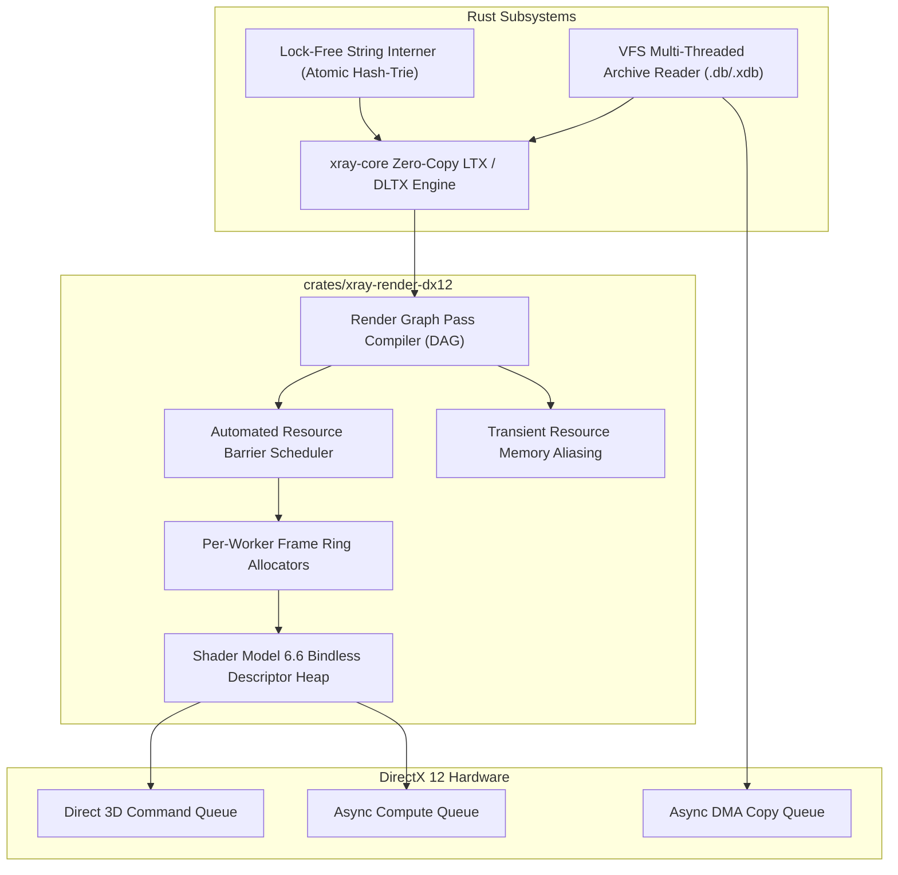
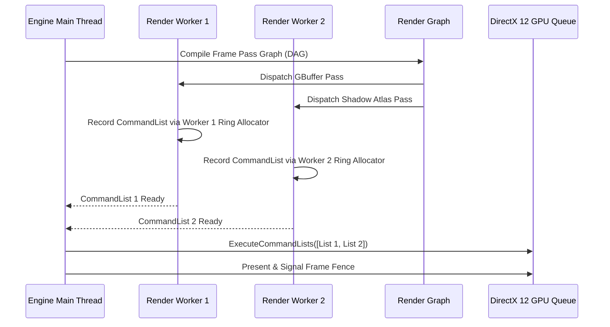

# Phase 2 Architecture Specification: Pure Rust DirectX 12 Backend & Core Subsystems

## 1. Executive Summary & Objective

Phase 2 transitions the X-Ray Monolith Engine (`xray-anomaly`) from configuration parsing scaffolding into modern graphics and systems architecture. Rather than reproducing the legacy fixed-slot DirectX 9/10/11 rendering pipelines or legacy single-threaded subsystems, Phase 2 implements a high-performance **DirectX 12** renderer and concurrent core engine primitives written in modern Rust.



---

## 2. DirectX 12 Render Backend Architecture (`crates/xray-render-dx12`)

### 2.1 Bindless Descriptor Architecture (Shader Model 6.6 / Resource Heap Tier 2)

Legacy X-Ray relied on DX9 fixed-function states and DX11 slot-based bindings (`t0`–`t128` per shader stage), forcing frequent pipeline state changes and descriptor table rebinding for every draw call.

Phase 2 replaces slot bindings with **fully bindless descriptor indexing**:

- **Unbounded Resource Heaps:** All textures, buffers, and samplers are allocated in a single global GPU-visible descriptor heap (`CBV_SRV_UAV`).
- **Shader Model 6.6 Resource Descriptors:** HLSL shaders access textures and buffers directly via 32-bit indices passed in root constants:
  ```hlsl
  struct DrawData {
      uint albedo_index;
      uint normal_index;
      uint material_index;
      uint transform_index;
  };
  ConstantBuffer<DrawData> g_Draw : register(b0);

  float4 PSMain(VSOutput input) : SV_Target {
      Texture2D albedo = ResourceDescriptorHeap[g_Draw.albedo_index];
      Texture2D normal = ResourceDescriptorHeap[g_Draw.normal_index];
      return albedo.Sample(SamplerDescriptorHeap[0], input.uv);
  }
  ```
- **Root Signature Layout:**
  - `Root Parameter 0`: 32-bit Root Constants (push constants, up to 16 `DWORD`s: material index, instance ID, frame constant buffer pointer).
  - `Root Parameter 1`: Frame Constant Buffer View (Camera, Projection, Time, Lighting totals).
  - `Root Parameter 2`: Bindless Heap Pointer table.
  - Zero descriptor table switching across standard draw calls.

### 2.2 Multi-Threaded Command List Recording

Modern systems feature 4 to 16+ CPU cores. Phase 2 eliminates the legacy single-threaded render loop (`Layers/xrRenderDX11/dx11HW.cpp`):



- **Per-Worker Command Allocators:** Each worker thread maintains dedicated `ID3D12CommandAllocator` ring buffers indexed by frame flight index (`frame % 3`).
- **Zero Allocator Contention:** Threads record completely in parallel with zero mutex locks.
- **Flight Synchronization:** 3 frames in flight (Triple Buffering) gated by fence points (`Signal` and `GetCompletedValue`).

### 2.3 Render Graph Pass Compiler & Transient Memory Aliasing

Rather than hardcoded sequential rendering, all passes (GBuffer, Shadow Mapping, Tiled Deferred Lighting, Volumetric Fog, Post-Processing, UI) are declared as nodes in a Render Graph DAG:

1. **Automatic Barrier Scheduling:**
   - Passes declare resource inputs (e.g. `Read(GBufferAlbedo, PixelShader)`) and outputs (e.g. `Write(GBufferAlbedo, RenderTarget)`).
   - The graph analyzes usage transitions and injects batched `D3D12_RESOURCE_BARRIER` calls immediately before pass execution, eliminating redundant state flushes.
2. **Transient Memory Aliasing:**
   - Non-overlapping passes (e.g. Shadow Map generation and Post-Processing Bloom buffers) share the same underlying physical VRAM heap (`D3D12_RESOURCE_HEAP_TIER_2`).
   - Reduces total render target memory consumption by **40% to 60%** compared to legacy X-Ray static allocations.

---

## 3. High-Performance Core Subsystems

### 3.1 Lock-Free Global String Interner (`crates/xray-core/src/string_table.rs`)

Legacy X-Ray uses `shared_str` (`src/xrCore/xrstring.cpp`), which locks a global critical section on every string allocation, causing severe lock contention on modern multi-threaded engines.

Phase 2 replaces this with a **concurrent lock-free string interner**:
- **Atomic Hash-Trie / Segmented Buckets:** Thread-safe read/intern operations using atomic CAS (`AtomicPtr`) without global mutex locking.
- **Cache-Aligned 64-bit Symbol IDs:** 64-bit interned IDs encode hash and buffer offset, allowing $O(1)$ equality comparisons (`id_a == id_b`) with zero pointer chasing.

### 3.2 Multi-Threaded VFS Archive Decompressor (`crates/xray-vfs`)

Legacy X-Ray reads packed `.db` and `.xdb` archives sequentially. Phase 2 introduces:
- **Parallel Chunk Decompression:** Worker threads decompress LZO and PPMd compressed chunks concurrently using Rayon.
- **Direct Memory-Mapped I/O:** `CreateFileMapping` / `MapViewOfFile` zero-copy paging for asset stream buffers.

---

## 4. Phase 2 Project Layout

```text
crates/
├── xray-core/               # Foundation (LTX, DLTX, String Table, Math)
│   ├── src/
│   │   ├── lib.rs
│   │   ├── string_table.rs   # Lock-free global string interner
│   │   └── vfs_types.rs      # Common filesystem primitives
├── xray-core-ffi/           # Safe C ABI exported to xrCore
├── xray-vfs/                # Modern VFS archive engine (.db / .xdb)
│   ├── Cargo.toml
│   └── src/
│       ├── lib.rs
│       ├── lzo.rs            # SIMD-accelerated LZO decompression
│       └── archive.rs        # Parallel chunk unpacker
└── xray-render-dx12/        # Pure Rust DirectX 12 render backend
    ├── Cargo.toml
    └── src/
        ├── lib.rs
        ├── device.rs         # DX12 Device, Queues, SwapChain
        ├── bindless.rs       # Shader Model 6.6 descriptor heap
        ├── graph.rs          # Render Graph DAG compiler
        ├── barriers.rs       # Automated barrier scheduler
        └── allocators.rs     # Multi-threaded frame ring allocators
```

---

## 5. Acceptance Gates for Phase 2

1. **Gate 2.1 (DX12 Device & Bindless Init):** `xray-render-dx12` initializes a modern DirectX 12 device, direct queue, and global bindless descriptor heap with validation layers enabled.
2. **Gate 2.2 (Multi-Threaded Command Recording):** Worker threads concurrently record commands using flight allocators with zero race conditions.
3. **Gate 2.3 (Render Graph Validation):** Render Graph DAG compiles 3 passes (Clear $\rightarrow$ Draw $\rightarrow$ Present) with automated barrier transitions.
4. **Gate 2.4 (Lock-Free String Interner):** Replaces `shared_str` lock contention, verified with 16 concurrent threads reading and interning 100,000 strings.
5. **Gate 2.5 (VFS Decompressor Parity):** Decompresses real Anomaly archive chunks matching legacy C++ MD5/SHA256 digests.
